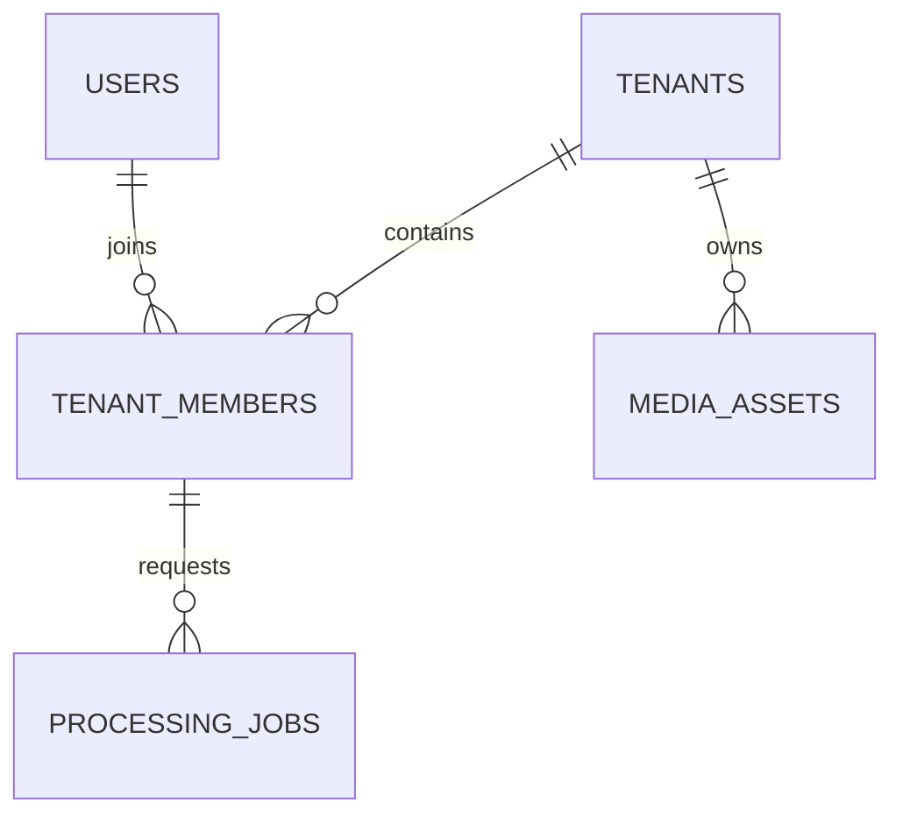

# 数据库设计 V1

当前固定0027、38表。0025_manual_first_note扩展人工首篇策略，保留tenant/note/snapshot/revision证据绑定，空base仅首篇，当前有效操作者/幂等摘要及同事务审计，不伪造AI run。

0026_research_answers新增research_runs/research_citations两表：tenant/idempotency唯一，actor/请求摘要绑定；仅pending可更新终态及answer/error列。引用不可改/删，tenant/run、tenant/note/snapshot/revision、tenant/revision/snapshot/evidence_key复合FK；INSERT RLS核对精确引文/标题/版本/来源及pending本人run，SELECT只允许有效本人。GET最近20本人记录不收费。

0027_source_schedules新增source_schedules/source_schedule_ticks/source_schedule_jobs三表。每人/来源唯一计划，版本/间隔/active/到期/错误；最小全局ticks发现而非授权；不可变任务关系复合绑定tenant/成员/来源/实际任务。业务表FORCE RLS/最小UPDATE；Worker复验且暂停取消未完成任务，网络后再检查。0025–0027已应用冻结；38表/2对象独立实例恢复含真实业务读取，证据见PROGRESS。

0024_concept_cards：knowledge_concepts保存不可变人工名称/定义、请求幂等摘要与操作者，tenant/note/snapshot/revision复合FK及tenant/revision/snapshot/evidence_key复合FK绑定准确证据。追加证据四元组唯一键，FORCE RLS/仅SELECT和INSERT/当前成员作者；应用锁后复验、配额与审计原子提交。147项真实集成及33表含概念数据新目标加密恢复已通过，迁移已冻结；维护docs/concept-cards.md。

## 当前快照与知识增量

0019_note_links追加第31张业务表，以tenant/left_note/right_note唯一且left<right保存无方向人工链接。
两端笔记及创建/最后操作者均使用租户复合外键；仅active/updated_by/updated_at可更新。
FORCE RLS要求有效成员并绑定当前actor，双端索引支持从任一笔记读取；真实验收状态见PROGRESS.md。

0018_note_annotations追加第30张业务表，绑定tenant/note/snapshot/revision四列复合关系与作者成员。
仅SELECT/INSERT，FORCE RLS校验有效成员、actor及修订document中的原段引文；索引按租户/笔记/修订/时间/UUID分页。
幂等键空间内唯一并绑定作者与请求摘要；应用层租户锁串行化配额，notes.annotated与批注同事务追加。
新schema的30表真实验收及加密恢复证据见PROGRESS.md。

固定0013_source_snapshots建立追加内容快照，绑定tenant/source/job/member复合外键，
唯一(tenant,source,version)及(tenant,job)，保存正文、原响应SHA-256、平台字段与局限。
0015_source_import追加provenance：历史默认platform_collection，授权正文/字幕为user_import。
INSERT RLS要求本人的running source_collect/source_import任务，来源ID与任务payload实际来源一致，
kind与provenance匹配；人工导入platform固定user_import、关联canonical URL必须匹配，不声称实际访问。
raw_sha256对采集为原响应摘要，对人工导入为原UTF-8输入摘要；运行角色仍仅SELECT/INSERT。
人工正文经真实任务/outbox/独立Worker消费者写入，不创建空任务或伪造远端采集。
固定0014_knowledge_notes建立note_runs/notes/note_revisions/note_sections/evidence_items五表，
归属均受FORCE RLS与租户复合外键保护。run幂等键绑定actor/snapshot，pending只能转终态，
UPDATE只授予status/error_code列；其余四表仅追加。修订必须匹配本人的pending run、快照与来源，
子章节和证据必须属于本人修订，证据snapshot必须与修订一致。JSON/正文/引文有数据库边界。
新增source.snapshot.created、notes.generated与source.content.imported审计，同事务提交；全库当前27表，验收以最新报告为准。
0016_note_edits只给note_revisions追加origin/base_revision_id/edit_key/request_sha256，表总数仍27。
ai_generated保持非空pending run绑定；user_edit要求run_id为空、真实base与幂等摘要非空。
base以tenant/note/snapshot/revision四列复合外键约束，人工INSERT还绑定有效成员、当前actor与版本递增。
应用授权事务串行化写入，先幂等回放再检查最新base；修订/章节/证据与notes.edited审计同事务追加。
个人理解与人工标识写入结构化document并同源渲染Markdown，不修改旧版本或伪造生成run。
0017_note_labels追加knowledge_labels和note_labels，全库当前29表；验收以PROGRESS.md最新记录为准。
knowledge_labels按tenant/kind/name_key唯一，空间分类仅追加；名称NFKC/空白合并，name_key用casefold。
note_labels按tenant/note/label唯一，以active保存关联状态，保留created_by与updated_by/updated_at。
两表FORCE RLS校验租户和有效成员，INSERT绑定当前actor；关联只授予active/updated_by/updated_at列更新权限。
tenant与笔记、分类、创建/最后操作成员使用复合外键；不存在应用角色删除或改写关联身份的权限。
分类与笔记修订独立，主题/标签不会改写来源、证据或历史。0021/0022追加名称/归档/版本与当前成员updated_by；0023追加nullable parent_id、同租户同类型复合FK/check/index与最小列权限。invoker触发器租户锁/祖先共享锁及100层有界循环检测；层级管理消费者复用版本/原子审计，标签无上级。概念/语义图谱/向量消费者仍待实现；人工链接图已另行实现。见docs/topic-hierarchy.md。

## 已建立的第一份迁移

PostgreSQL 16 + vector extension。迁移 0001_foundation 建立以下最小表；UUID 由应用生成。
不提前创建几十张没有代码消费者的空表。表中时间采用 timestamptz/UTC。

| 表 | 关键列/索引 | 约束与隔离 |
|---|---|---|
| users | UUID PK、email UNIQUE、password_hash、status、created_at | FORCE RLS；app.user_id=self |
| tenants | UUID PK、name、status、created_at | FORCE RLS；id=app.tenant_id |
| tenant_members | (tenant_id,user_id) PK、role | 外键到 tenant/user；owner/admin/member；FORCE RLS |
| processing_jobs | UUID PK、tenant_id、requested_by、kind、status、progress、idempotency_key、error_code、payload JSONB、created_at | (tenant_id,id) UNIQUE；(tenant_id,idempotency_key) UNIQUE；(tenant_id,requested_by) 复合成员外键；FORCE RLS |
| media_assets | UUID PK、tenant_id、storage_key、mime_type、size | (tenant_id,storage_key) UNIQUE；FORCE RLS |

jobs：progress 0–100；status ∈ queued/running/succeeded/failed/cancelled；索引 (tenant_id,status)。
注册和空间授权已通过真实验收；持久化任务在0003_jobs中扩展，租户文件API在0004_assets后已验收。
0003_jobs 增加 tenant_members.active（撤销保留历史外键）、processing_jobs 的 result/attempt_count/lease_until，
并建立带租户复合外键与 FORCE RLS 的 job_steps/job_attempts。
job_dispatches 是全局调度索引，仅含 dispatch/job/tenant/user UUID、due_at/done，不能存业务 payload 或秘密。
Worker 必须重新验证成员和任务归属后才能读租户数据；运行角色不持有 bypass 权限。
0004_assets 增加 uploaded_by（租户复合成员外键）、status/filename/created_at，
保留历史基础设施行的 legacy 状态且不可经文件 API 读取，不删除既有数据。
pending/ready/deleting 生命周期与配额预留支持中断恢复，客户端不可指定 storage_key。

0005_ai_settings 建立租户 ai_providers/ai_usage 与个人空间 user_settings；密钥仅存版本化密文，
每日配额先持久化预留，未知费用为空。0006_audit 建立租户 audit_events：id/tenant_id/actor_id/
action/resource_id/created_at，初始12种动作、复合成员外键、(tenant_id,created_at,id)分页索引。
审计SELECT受租户RLS，INSERT还绑定 app.user_id；knowledge_app 仅SELECT/INSERT，禁止修改/删除。
审计与业务同事务，不从请求接受任意文本字段，不对既有数据伪造历史事件。
0008追加DeepSeek类型；0009固定扩展审计动作白名单为13种（新增provider.updated），不改历史迁移或删除数据。
Provider更新保持id/kind与usage复合关系，历史usage.model不随配置修改；未传新密钥保留原密文，停用清钥。

## RLS 与角色

0002_identity 增加 auth_identities(email → user_id) 和 auth_sessions(token_hash,user_id,expires_at)。
两表是最小全局认证索引，令牌明文不落库；密码仍在 users 的 self-only RLS 下。
0007_auth_recovery增加users.email_verified（既有账户默认false）与auth_action_tokens：
token_hash为主键，user_id外键、purpose、expires_at、created_at；运行角色仅SELECT/INSERT/DELETE。
操作令牌仅存SHA-256，绑定用途/用户；消费先锁用户再重新读取令牌，重置同事务撤销全部会话/链接。
0010_auth_security_events建立全局账户安全历史，id UUID主键、user_id可空外键、action、created_at、bucket_start。
成功事件与身份事务一致；失败动作必须带数据库15分钟窗口，其他动作不带窗口，匿名仅允许login.failed。
部分唯一索引(user_id,action,bucket_start)使用NULLS NOT DISTINCT合并匿名桶；
另一索引(user_id,created_at,id)支持自身稳定游标分页。记录不含邮箱/IP/凭据/任意文本。
FORCE RLS SELECT绑定app.user_id，INSERT绑定自身或空上下文匿名失败，created_at必须为事务now()；
knowledge_app仅SELECT/INSERT，不得改删。无显式冲突目标的DO NOTHING保持匿名插入不触发SELECT RLS。
用户外键不级联删除安全历史，既有账户不回填虚构事件；账户删除/保留政策需单独评审。
tenant_members 允许 app.user_id 发现自身成员记录；tenants 允许自身成员 SELECT，
写操作仍受事务 app.tenant_id 约束。API 在设置租户上下文前验证成员。

租户范围表达式：NULLIF(current_setting('app.tenant_id', true), '')::uuid。
每个租户表 ENABLE + FORCE ROW LEVEL SECURITY，USING/WITH CHECK 双向约束。
users 使用 app.user_id；身份表未来需要独立、最小权限的注册/认证流程，不能放宽为任意读写。
knowledge_app 只被授权指定业务表 DML 与 alembic_version SELECT，不是 owner/超级用户。
migration URL 不注入运行服务。SET LOCAL/事务内 set_config 避免连接池跨请求泄漏。
复合外键阻止 A 租户任务关联 B 租户成员。后续 source/note/asset 关系也采用同类复合外键。

真实 RLS 集成测试见 tests/test_tenant_rls_integration.py：无上下文拒读，双租户交叉拒读/拒改/拒写，
跨租户成员关联拒绝。测试使用回滚事务，不在数据库持久化示例用户。
当前测试覆盖数据库隔离，不代表 API、向量和对象下载隔离已验收。

## 后续领域（已实现部分与设计预留）

- 身份/计费：plans、subscriptions、api_keys（只存 hash）、user_settings、ai_provider_configs（加密）、usage_records。
- 采集：当前已建立 `source_batches` 与 `sources`，保存租户内 URL 候选的原始/规范值、接受/拒绝状态、
  固定拒绝码和创建批次；复合外键、FORCE RLS、租户 canonical SHA-256 唯一约束、每日批次/总量配额已接入。
  批次绑定真实成员、UUID 幂等键和输入 SHA-256；tenant 锁下串行检查重试/配额/去重。
  运行角色仅 SELECT/INSERT；非法链接原文替换为 `[blocked]`，只持久化固定拒绝原因。
  0011 为固定建表迁移，0012 扩展固定审计动作 `source.batch.created`，已有迁移保持冻结。
  `source_snapshots`已由0013实际采集消费者建立；`collections`、`collection_items`、`source_tags`仍待对应消费者。
  后续按真实消费者增加平台 external_id、标题、作者、类型、时长、封面引用和 metadata。
  去重限定租户；平台 identity 具体约束在适配器验证后确定，不承诺尚未确定的永久保留政策。
- 提取/任务：job_steps、job_attempts、transcripts、transcript_segments（独立 start_ms/end_ms/text）、
  comments、comment_replies、danmaku；不得把长字幕全部塞进一个 JSON 字段。
- 知识：notes、note_revisions、note_sections、evidence_items、note_annotations、note_embeddings、ai_runs、ai_templates。
  Markdown 与章节同一个生成版本，修订单调版本号。嵌入维数随模型/集合设计，禁止跨模型向量直接比较。
- 图谱：topics、tags、concepts、note_topics/tags、knowledge_relations、entity_mentions、graph_snapshots。
  关系有证据/置信度/生成方法；SUPPORTS、CONTRADICTS、EXPLAINS 等不等于同标签。
- 学习/自动化：learning_plans、review_tasks、learning_records、reminders、sync_schedules、export_tasks、
  notification_events、audit_logs。

所有用户数据表有 tenant_id 或受严格约束的父表租户继承；向量和图谱查询显式过滤与 RLS 双重防线。
每次新增 schema 使用独立 Alembic migration；已发布迁移不得随 ORM 模型改变。
未上线前可以数据库重建验证，但删除卷/降级等破坏性操作必须另获用户明确授权。
